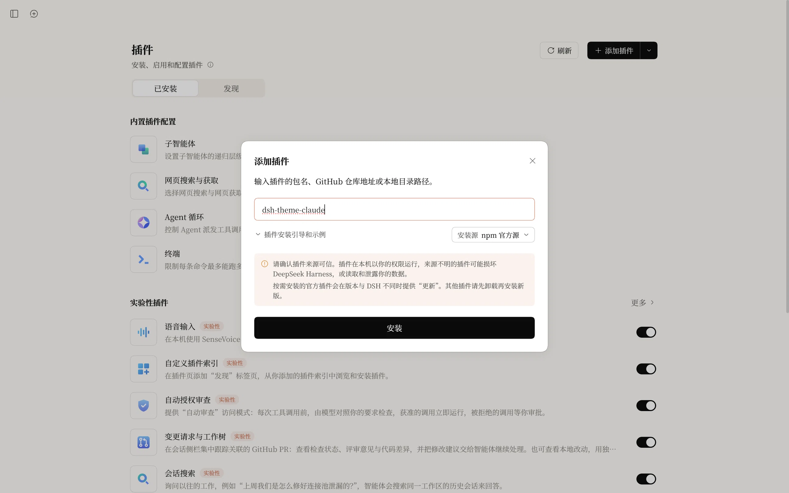
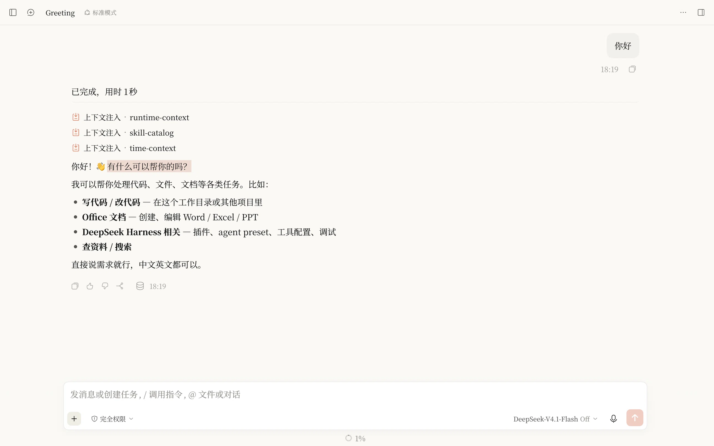

# dsh-theme-claude

把 [DeepSeek Harness](https://github.com/deepseek-ai) 的 Web 界面换成 Claude 的视觉语言。

主题覆盖 Harness 自带的设计令牌，再加一层组件级 CSS。会话逻辑、工具行为和快捷键都不变。

> 主题不只换色，还改了几处界面。安装前请先读 [界面变化](#界面变化)。

_预览图只取空白会话：真实会话的标题会暴露隐私，所以图里没有真实对话。_

## 改了什么

| 层次 | 内容 |
| --- | --- |
| **表面** | 画布 `#faf9f5` / 侧栏 `#f0eee6` / 卡片 `#ffffff`；暗色 `#151515` / `#0b0b0b` / `#1a1a19`–`#20201f`；浮层 `#262624` |
| **边框** | 跟随 CDS 透明度阶梯：5% / 10% / 20% / 35%，暗色下翻转为白色 |
| **文字** | `#0b0b0b` 主 / `#52514e` 次 / `#898781` 弱；暗色 `#f0efec` / `#c3c2b7` / `#898781` |
| **强调色** | 链接（含文件链接）用品牌陶土 `#c6613f`，暗色 `#e0895f`。陶土橙 `#c6613f` / `#d97757` 留给发送按钮这类动作和按钮的焦点环。文字输入框不画焦点环 |
| **圆角** | `5 / 7 / 8 / 10 / 14 / 18px`，输入框 14px，面板 10px，消息气泡 18px |
| **投影** | CDS `sm` / `md` / `lg` 三级阴影，浮层双层扩散，输入框内嵌发丝边 |
| **排版** | 全局衬线字体，正文 17px 起步，设置 → 外观 的字号会叠加在上面；行高 1.6，标题 600 字重 |
| **动效** | CDS 5 阶时长（60 / 120 / 200 / 300 / 450 ms），15 段 `linear()` 弹簧曲线 |
| **组件** | 输入卡片、用户气泡、代码块、表格、菜单、提示条、对话框、附件卡片、回到底部圆钮 |

覆盖了全部 14 个官方 DSH 主题令牌，亮色和暗色各一套。

## 界面变化

以下改动超出换色范围，都是有意的。

| 变化 | 你会看到什么 |
| --- | --- |
| **全局衬线字体** | 正文、侧栏和菜单改用 `Noto Serif SC / Songti SC` 字体栈，不再是系统无衬线字体。这是最显眼的变化。 |
| **正文 17px 起步** | 正文字号从原生 14px 改为 17px。设置 → 外观 的字号调节依然有效，调大调小会在 17px 基线上叠加。 |
| **品牌字标隐藏** | 侧栏顶部的品牌行被移除，直接以「新对话」开头。 |
| **输入框状态行隐藏** | 输入框下方的 `[data-composer-stat]` 状态提示不再显示。 |
| **视图标签变胶囊** | 对话视图切换器从原生标签条变成 999px 胶囊分段控件。 |
| **消息操作 tooltip 上翻** | 操作行的 tooltip 改向上弹出，避免被常驻输入框遮挡。 |
| **任务面板间距已调整** | 输入框上方的待办面板与输入卡片之间留出 8px 间隙（原生用负外边距把两者挤在一起），面板内最后一条任务也不再贴住卡片底边。 |
| **列表板块不显示悬停底色** | 设置页、插件页、会话列表里整块的行和卡片，鼠标悬停时不再变色（整块变色像布局在晃，卡片还会溢出边界）。开关、按钮、链接自己的悬停反馈保留。 |
| **交付文件卡片与宽表** | 附件卡片改成 10px 圆角、暖色描边；四列及以上表格钉回正文列宽并自动换行。 |

想恢复其中任何一项，在插件里停用本主题，然后刷新页面。

## 界面预览





> 截图来自空白会话，不含真实对话内容。

## 安装

从 npm 安装：

```sh
dsh plugin add dsh-theme-claude
```

或在本地开发时用 `link:` 指向克隆下来的目录。

装完后要**硬刷新**页面（`⌘+Shift+R`）。Host 下发的插件 bundle 带 `immutable` 缓存头，普通刷新会继续用旧模块。

在插件里停用即可恢复原生界面，其他部分不受影响。

## 兼容性

基于 DeepSeek Harness `0.2.2-rc.5` 构建。令牌层覆盖能扛住版本更新。组件层规则靠类名主干和稳定的 `data-*` 钩子匹配，未来 DSH 大改版可能让个别细节失效，但配色和排版会继续生效。

已知限制：

- 正文从原生 14px 改成 17px 起步，在设置 → 外观 里仍然可调。
- 全局字体是衬线字体。这是刻意的选择，但会明显改变阅读观感。
- `:has()` 选择器没有加 `@supports` 兜底，超长会话快速滚动时可能有轻微性能开销。
- CDS 3.0 的 `@property` 滚动渐隐、`data-mode` 三态作用域和 55 项关键帧尚未实现，需要宿主提供 DSH 目前没有暴露的容器支持。

## 自定义

所有内容都由 `scripts/build.mjs` 生成：

| 想改什么 | 改哪里 |
| --- | --- |
| 配色 / 文字颜色 | `STATIC`、`LIGHT`、`DARK` 三个映射表 |
| macOS 专用取值 | `PLATFORM_LIGHT` / `PLATFORM_DARK` |
| 圆角、投影 | `GEOMETRY` / `GEOMETRY_DARK` |
| 字号体系 | `FONTS` |
| 动效时长 | 模板底部的组件规则 |
| 衬线侧栏、陶土点缀、组件形状 | 模板底部的组件规则 |

```sh
npm run build   # 重新生成 theme.css 和 client.js
npm run check   # 校验主题依赖的令牌与不变量
```

`npm run check` 是回归守卫：它会重新构建，并在任何一项令牌或不变量变化时报错。目前覆盖以下几类：

- 令牌取值，亮色和暗色两套
- CDS 5 阶时长标尺
- 文档一致性：README、DETAIL、CHANGELOG 与实际产物一致，已弃用的取值不再出现
- 三类悬停回归：容器背景溢出圆角、嵌套卡片层层上浮、板块元素不得有悬停底色
- 焦点回归：文本框不画焦点环；插件卡片无悬停溢出；选中行保留状态色
- 字号接线、任务面板间距、宽表钉列、代码块 `<pre>` 几何重述、同一选择器重复声明、宿主钩子是否还在 bundle 里

每次跑完会打印执行的守卫数，文档不再记数。

## 排查

- 插件显示「异常 / 不兼容」：bundle 声明了 `engines.dsh >=0.2.2-0`。不带 `-0` 后缀的版本范围匹配不上 `0.2.2-rc.5` 这类预发布版本。
- 装完看不到样式，或改了主题毫无变化：客户端模块在页面加载时挂载，刷新一次即可。改动主题时必须硬刷新（`⌘+Shift+R`，或开发者工具里的「清空缓存并硬性重新加载」）。普通刷新 `⌘R` 会继续复用旧模块，因为 Host 下发的插件 bundle 带 `immutable, max-age=31536000` 缓存头，浏览器认为这份 JS 永不过期。
- DSH 升级后界面不对：令牌层会继续生效，靠类名主干匹配的组件规则可能需要更新。跑一次 `npm run check` 确认产物完整。

## 开发

```sh
node scripts/build.mjs     # 从令牌映射表重新生成 theme.css 和 client.js
```

唯一源头是 `scripts/build.mjs`。配色表、圆角、字号体系和组件规则都在里面。生成的 `client.js` 内嵌 CSS，浏览器不需要额外请求。

## 许可

MIT。设计令牌的出处与商标说明见 [LICENSE](LICENSE) 和 [NOTICE.md](NOTICE.md)。

色板、圆角、阴影与排版密度取自 [open-claude-ui](https://github.com/Caho1/open-claude-ui)（MIT），并按该项目 v4 取证报告校正。主题不包含该项目的组件代码。

本项目与 Anthropic 无关，Claude 是 Anthropic 的商标。
